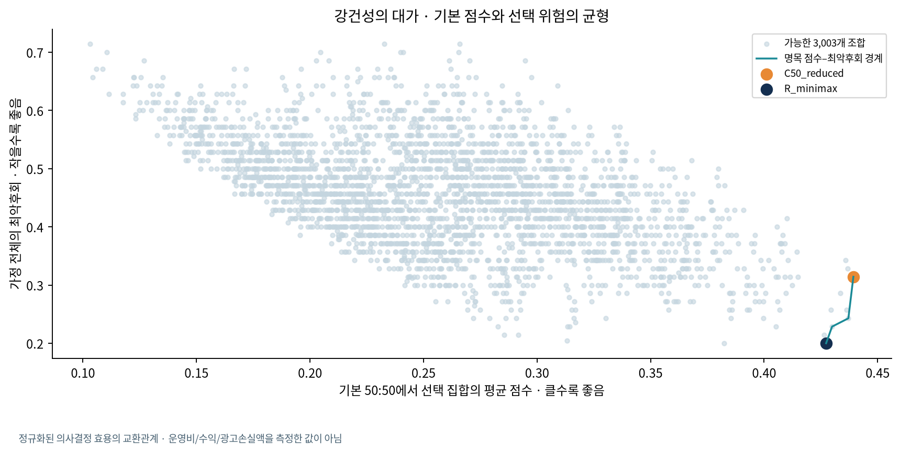

# Transit OOH 공개자료 기반 후보지역 선정 연구

2026-10-21 실행·검토. 정보통신공학 캡스톤디자인2와 산업공학회 경진대회를 위한 실제 자료 사례 연구다. 현장관측은 이번 완료 조건이 아니다.

**핵심 결과:** 마포구의 비교 가능한 15개 행정동 중 5곳을 선정하는 3,003개 조합을 모두 계산했다. 기본 50:50 방식의 최악후회는 0.3143, 제안한 강건 선택의 최악후회는 0.2000이었다. 대표 강건 조합은 기본 50:50 평균점수를 0.4393에서 0.4273으로 낮추는 대신 여러 가정의 최악 선택 손실을 줄였다. 이 값은 정규화한 의사결정 점수의 교환관계이며 광고효과·운영수익 개선율이 아니다.

공개 결과: [요약·해시](../reports/public_decision/summary.json), [가공표](../reports/public_decision/tables/), [연구 그림](../reports/public_decision/figures/), [재현 명세](PUBLIC_DATA_RESEARCH_PROTOCOL.md).

## 1. 문제와 연구 범위

배송차량 광고를 계획할 때 상권이 큰 곳과 차량 통행 맥락이 높은 곳은 일치하지 않을 수 있다. 운영자가 두 기준의 중요도를 아직 확정하지 못했다면 한 가지 가중치의 상위 지역만 제시하는 데 한계가 있다.

연구 질문은 **“선호 비중과 자료 표현이 달라져도 선택 손실이 작은 K개 후보지역을 찾을 수 있는가?”**다. 이 연구는 행정동 단위의 사전 선별을 지원한다. 실제 배송 정차지, 광고 설치 가능성, 경로의 운행 가능성, 광고 시청자 수와 전환을 관측하거나 확정하지 않는다. 기존 GPS 엔진과 View-T 인구·경로 화면은 보존하며 이번 축소형 집계 모형과 구분한다.

강건 최적화와 최악후회 최소화는 기존 의사결정 방법이다. 새 알고리즘이라고 주장하지 않는다. 이번 기여는 실제 공개자료 연결의 검증, 가중치·자료 표현에 대한 K개 지역의 공동 선택, 전 조합과 동점 공개, 실제 자료의 재현 가능한 비교, 사용자 GIS 구현에 있다.

## 2. 확보한 실제 자료와 정합성

| 자료 | 이번에 사용한 범위 | 역할과 제한 |
|---|---|---|
| 서울시 점포-행정동 OA-22172 | 2024년 4개 분기, 마포구 16개 동, 5,694개 동×분기×업종 행 | 보고된 점포 재고의 지역 규모 대리지표 |
| View-T 추정교통량과 도로망 | 2024년 평일 연평균, 보유 링크 408개 | 지역 차량 맥락. 실제 배송 GPS·고유 차량 수·광고 노출과 구분 |
| 서울시 추정매출-행정동 OA-22175 | 2025년 4개 분기 | 선택 결과와 관련성을 확인하는 추정 거래 맥락 |
| 기존 View-T 2024년 동 명칭·표시점 | 마포구 16개 동 | 코드 대조와 지도 표시. 실제 정차 위치가 아님 |

서울시 두 파일은 공식 HTTPS 다운로드로 확보했고 이번 수집에 API 키는 필요하지 않았다. 요청 조건·시각·크기·SHA256을 보존했다. 점포 ZIP은 1,082,408바이트, 거래 ZIP은 11,160,221바이트다. 공식 파일 목록에서 2026년 거래 파일은 확인하지 못하여 추가 연도 검사는 미실행으로 남겼다. 별도 2026년 API 제공 여부까지 부재로 단정하지 않는다.

**공간 연결:** 서울시 `11440…`와 View-T `11140…`는 코드 체계가 다르다. 접두사를 일괄 바꾸지 않고 서울 마포구로 제한한 뒤 16개 고유 동 명칭·연도·분기 내 일관성을 검증했다. 원본 도로망의 `k_link_id`, `emd_id`, `sigungu_id`, `k_length`로 408개 링크를 연결했고 ID·길이가 모두 일치했다. 원본 도로망 해시가 교통 메타데이터와 같아야 계산을 허용한다.

이는 기관이 링크에 부여한 동 코드로 보유 도로 맥락을 집계한 결과다. 웹 경계로 링크를 정밀 분할한 공식 동별 교통통계를 재생산했다고 주장하지 않는다. 마포구의 모든 생활도로를 확보했다는 뜻도 아니다.

**결측 처리:** 염리동은 보유 도로의 완전한 동별 맥락이 없어 후보 비교에서 제외했다. 도로가 없거나 실제 통행량이 0이라는 뜻은 아니다. 따라서 실제 비교 모집단은 **15개 동**이다. 후보·코드·제외 이유는 [대응·커버리지 표](../reports/public_decision/tables/coverage_and_crosswalk.csv)에 있다.

**점포의 의미:** CSV의 `유사_업종_점포_수`는 공식 필드 설명상 전체 점포이고, 각 행에서 일반 점포+프랜차이즈=전체가 성립하는지 검사했다. 세 값을 또 더하지 않았다. 동×분기별 보고 업종 수는 80~98개로 다르다. 누락 업종을 0으로 채우지 않고 **보고된 업종 합계**를 사용했다. 분기 평균은 연간 신규 점포 수가 아니다.

**기간과 측정량:** 점포는 분기 재고, 교통은 연평균 평일 맥락이다. 같은 2024년의 지역 특성으로 비교하지만 같은 시각·같은 방식의 관측치로 간주하지 않는다. 분기 차이는 시나리오로 검토한다. 인구 요청의 월~금 조건과 교통의 평일 조건에서 공휴일 정의가 같은지 확정되지 않아 인구를 이번 축소형 점수에 결합하지 않았다.

**자료의 지위:** 서울시 과거 자료는 현재 수정된 릴리스다. 2024년 당시 이용 가능했던 자료만으로 미래를 예측한 실험으로 설명하지 않는다. View-T는 기관 추정 교통 맥락 입력으로 사용하며 제공자의 이용정책에 따라 광고효과의 독립 정답으로 사용하지 않는다. 서울시 자료의 표시 이용조건은 공공누리 1유형(출처표시)이다. 기관 원본·개별 O/D·인증키는 공개 배포 대상에서 제외한다.

## 3. 점수와 비교 모형

기본 공간 성분 A는 2024년 보고 전체 점포 수의 분기 평균이다. 이동 성분 B는 보유 링크 중 고속도로·도시고속도로·고속도로 연결로를 제외한 도로의 길이 가중 차량 맥락이다.

`Bᵢ = Σ(기관이 동 i에 부여한 링크의 연장 × 추정 교통량) / Σ(같은 링크의 연장)`

같은 후보군에서 각 성분을 정규화한 후 `Cᵢ(α) = (1−α)Aᵢ + αBᵢ`로 계산한다. α는 차량 맥락의 비중이다. 기본 α=.5와 비교 α=.6은 초기 의사결정 가정이며 경험적으로 검증된 최적 가중치가 아니다.

| 모델 | 같은 K개 후보를 고르는 방법 |
|---|---|
| A_stores | 정규화한 보고 점포 재고의 상위 K개 |
| B_vehicle_context | 정규화한 일반도로 차량 맥락의 상위 K개 |
| C50_reduced | 50:50 축소형 통합점수의 상위 K개 |
| C60_reduced | 60:40 축소형 통합점수의 상위 K개 |
| R_minimax | 아래 시나리오 전체의 최악후회가 최소인 K개 집합 |

`reduced`는 인구·POI를 포함한 기존 전체 Spatial 및 GPS 정차·방문 Mobility와 측정량이 다름을 드러내는 이름이다. 연평균 교통량만으로 정차시간·반복 방문을 생성하지 않았다. 점포 합계는 지역 규모이며 면적당 밀도·점포 품질·광고효율은 아니다.

## 4. 불확실성과 공동 선택

자료 시나리오는 점포 4분기+분기평균 5종, 전체 차량/트럭×전체/일반도로 교통 4종, min–max/log1p–minmax/평균 동점 순위 변환 3종이다. 주 선호 범위는 α∈[0,1], 보조 범위는 [.3,.7]이다. 주 분석 K=5, 보조 K=3/10을 모두 공개한다. 운영상 최적 K나 선호 분포를 학습했다는 뜻은 아니다.

시나리오 s와 가중치 α에서 집합 P의 효용은 선택한 K개 지역 점수의 평균이다.

`U(P,s,α) = (1/K) Σᵢ∈P Cᵢ(s,α)`

`Regret(P,s,α) = max_{|Q|=K} U(Q,s,α) − U(P,s,α)`

`P* = argmin_{|P|=K} max_{s,α∈[a,b]} Regret(P,s,α)`

후회는 그 조건을 미리 알았을 때의 최선 집합과 현재 선택의 평균 점수 차이다. 실제 후회 설문·광고 손실액·실패확률이 아니다. K개 지역을 **공동 선택**하므로 개별 후보의 강건 순위 상위 K개와는 다른 문제다.

고정된 자료 표현에서 효용은 α의 선형함수다. 최선 집합 효용은 유한한 선형함수들의 최댓값으로 볼록하며, 현재 집합의 선형 효용을 뺀 후회 역시 볼록하다. 따라서 구간 내부의 후회는 끝점의 최댓값을 넘지 않는다. 정해진 시나리오에서는 양 끝을 검사하여 연속 가중치 범위의 최악값을 포괄한다.

설계 행은 5×4×3×2=**120개**, 고유 점수 벡터는 **25개**다. 가중치가 0 또는 1일 때 일부 표현의 점수가 중복되므로 120을 독립 표본 수로 부르지 않는다. 평균 시나리오 후회는 이 설계 행의 동일 비중 기술통계이며 확률분포의 기대손실이 아니다.

K=5에서 가능한 **3,003개 집합**을 전부 탐색했다. 동점 허용오차는 1e−12, 대표 선택은 동 코드 순이다. 이 최적성은 후보군·K·가산 효용·시나리오 내의 조건부 보장이다. 지역 간 상호작용, 동일 통행의 중복 노출, 경로 연결·시간창·비용·용량·정차 허용 제약은 포함하지 않았다.

## 5. 주 결과와 강건성의 대가

주 조건: 비교 가능한 마포구 15개 동, K=5, α 범위 0~1.

| 모델 | 최악후회 | 기본 50:50 평균점수 | 기본 최선 대비 평균점수 손실 |
|---|---:|---:|---:|
| A_stores | 0.4143 | 0.3448 | 0.0945 |
| B_vehicle_context | 0.4000 | 0.3665 | 0.0728 |
| C50_reduced | 0.3143 | **0.4393** | 0.0000 |
| C60_reduced | 0.3143 | **0.4393** | 0.0000 |
| R_minimax, 코드순 대표 | **0.2000** | 0.4273 | 0.0120 |

출처: [모델 비교](../reports/public_decision/tables/portfolio_comparison.csv), [강건성의 대가](../reports/public_decision/tables/price_of_robustness.csv).

**제안 선택은 명목 50:50 효용 0.0120을 포기하고 최악후회 0.1143을 줄였다.** 운영자가 기본 점수 최댓값을 원하면 C50이 맞고, 명시한 조건 전체의 최악 손실을 줄이려면 R이 맞다. 두 기준 사이의 선택을 보여 주는 결과다. 광고효과 36% 향상이나 비용 절감률로 바꾸지 않는다.



전체 조합의 명목 효용·최악후회와 경계 대표는 [전 조합 표](../reports/public_decision/tables/all_portfolios_tradeoff.csv)에 있다. R이 학습 시나리오의 최악후회를 최소화하도록 설계되었으므로 같은 시나리오의 우위만으로 독립적인 실증 성능을 주장할 수 없다.

**최적 조합은 2개다.**

| 최적 조합 | 선정 동 | 최악후회 | 기본 50:50 평균점수 |
|---|---|---:|---:|
| R_optimum_1, 코드순 대표 | 용강·서교·합정·망원2·상암 | 0.2000 | 0.4273 |
| R_optimum_2 | 용강·서교·합정·성산2·상암 | 0.2000 | 0.3824 |

공통 후보는 용강·서교·합정·상암, 대체 후보는 망원2와 성산2다. 최악후회가 같아도 명목 점수와 다른 보조 기준은 다를 수 있다. 거래 비중이 높은 조합으로 대표를 사후 교체하지 않았다. [모든 최적 조합](../reports/public_decision/tables/all_optimal_sets.csv)과 [공통·가능 후보](../reports/public_decision/tables/optimal_set_ties.csv)를 공개한다.

## 6. 후보 수·가중치·제외 조건 검사

| K | 차량 비중 범위 | C50 최악후회 | R 최악후회 |
|---:|---|---:|---:|
| 3 | 0~1 | 0.2857 | 0.2857 |
| 5 | 0~1 | 0.3143 | 0.2000 |
| 10 | 0~1 | 0.1714 | 0.0929 |
| 3 | .3~.7 | 0.1595 | 0.1343 |
| 5 | .3~.7 | 0.1943 | 0.0843 |
| 10 | .3~.7 | 0.1071 | 0.0393 |

K=3의 전체 범위에서는 C50과 R의 선택 및 최악후회가 같다. 모든 조건에서 엄격한 개선이 있는 방법은 아니다. 범위가 다른 두 실험은 평가하는 최악 조건 자체가 달라지므로 숫자 차이를 일반적인 성능 향상률로 해석하지 않는다.

기본 50:50 대비 α=.6의 Spearman은 **0.9786**, Top-5/10 중복률은 모두 **100%**다. α=0일 때 Spearman은 0.2607, Top-5는 60%; α=1일 때 각각 0.8000, 80%다. 0.05 간격 요약 외에 연속 교차점·순위 구간도 공개했다. 기준 자신과의 비교인 α=.5의 100%는 기술적 확인이며 안정성의 새로운 증거가 아니다.

**분기 제외:** 한 분기를 뺀 나머지 3개 분기로 선택하고 제외 분기에서 평가했다. 학습의 점포 평균에서도 제외 분기를 제거했다. 네 번 모두 코드순 대표 R이 유지되었고 제외 조건 최악후회는 0.2000이었다. 같은 지역의 인접 분기이므로 독립 미래 예측 실험으로 부르지 않는다. [분기 제외 원표](../reports/public_decision/tables/held_out_quarter_specification.csv).

**도로·정규화 정의 제외:** 도로 표현 4개와 정규화 3개를 각각 빼고 R을 선택한 뒤 제외 정의에서 평가했다. R의 제외 조건 최악후회는 **0.0898~0.2000**이었다. 일반도로 전체 차량 표현을 제외하면 대체 후보가 망원2에서 성산2로 바뀌었고 공통 4개 동은 유지됐다. A/B/C는 미리 정한 기준선이다. [정의 제외 원표](../reports/public_decision/tables/held_out_definition_specification.csv).

분기 4개를 충분한 독립 표본처럼 Bootstrap하지 않았다. 기존 실제 19일 인구의 날짜/주 재표집 결과는 별도 인구 통행량 기술분석이며 이번 연평균 교통·점포 모형의 성능 신뢰구간이 아니다.

## 7. 외부 거래 자료: 유리한 결과와 불리한 결과

2025년 예비 결과를 이전 작업에서 이미 접했으므로 이번 명세는 결과 미관측 사전등록이 아니다. 입력·점수·선택·코드 해시를 기록하고 거래 값을 solver에 전달하지 않는 계산상의 분리는 확인했지만, 연구자의 이전 결과 인지를 없애지는 못한다. 따라서 **회고적·탐색적 외부 상권 맥락 확인**으로 보고한다. 선택을 2025년 결과에 맞춰 다시 고르지 않았다.

거래 비중은 **선정한 5개 동의 보고 추정 거래 건수 합계 / 비교 가능한 15개 동의 같은 범위 합계**다. 마포구 전체나 서울시 전체의 비중, 실제 광고 도달률, 고유 고객 수가 아니다.

| 2025Q1 모델 | 보고 추정 거래 비중 | 점수–거래 Spearman | 동 하나씩 제외한 상관 범위 |
|---|---:|---:|---:|
| A_stores | 57.28% | **0.6036** | 0.5121~0.7582 |
| B_vehicle_context | 21.01% | 0.0179 | −0.1473~0.1209 |
| C50_reduced | 51.17% | 0.3036 | 0.1429~0.4242 |
| C60_reduced | 51.17% | 0.2643 | 0.1077~0.3582 |
| R_minimax, 코드순 대표 | 60.60% | 해당 없음 | 해당 없음 |

R은 집합을 고르므로 단일 후보 순위를 만들어 Spearman을 부여하지 않았다. 동 제외 범위는 영향도 진단이며 95% 신뢰구간이 아니다. 공간 의존성을 무시한 p값으로 우월성을 판정하지 않는다.

**점포 단독의 거래 순위상관이 통합점수보다 높았다.** 교통을 결합하면 거래 예측력이 항상 좋아진다는 가설은 지지하지 않는다. 다른 최적 R 조합의 Q1 거래 비중은 60.91%이지만 이 값을 보고 대표를 바꾸지 않았다.

다른 분기도 모두 공개한다.

| 모델 | Q1 | Q2 | Q3 | Q4 |
|---|---:|---:|---:|---:|
| A_stores | 57.28% | 55.92% | 57.67% | 56.78% |
| B_vehicle_context | 21.01% | 20.08% | 20.74% | 21.33% |
| C50_reduced | 51.17% | 49.96% | 50.99% | 50.68% |
| C60_reduced | 51.17% | 49.96% | 50.99% | 50.68% |
| R_minimax, 코드순 대표 | 60.60% | 59.20% | 60.04% | 59.02% |

출처: [외부 관련성 전체](../reports/public_decision/tables/external_context_association.csv), [동점 조합 전체](../reports/public_decision/tables/external_context_all_optima.csv).

**거래 측의 보고 업종 범위를 통일하면 다른 결론도 나온다.** 거래의 동×분기별 보고 업종 수는 34~56개다. 모든 후보·분기에 공통으로 보고된 18개 업종만의 보조 검사에서 Q1의 A 거래 비중은 **62.28%**, 코드순 대표 R은 **62.16%**로 A가 조금 높다. 다른 동점 R은 63.43%이지만 유리한 조합으로 사후 교체하지 않는다. 입력 점포 지표와 선택은 원래의 보고 전체 점포 기준으로 고정되어 있으며, 이 보조 검사는 거래 측의 보고 범위만 통일한 것이다. 동일 업종의 점포당 거래효율을 측정한 결과가 아니다. 이 범위 점검은 보고 여부로 정의하며 거래값이 높은 업종을 고른 것이 아니다. 누락 업종은 0으로 채우지 않았다. [공통 업종 결과](../reports/public_decision/tables/external_context_common_sectors.csv).

점포와 거래는 모두 서울시 상권분석 체계의 산출물이고 거래 자체도 카드사 기반 추정치다. 원천·추정 과정의 완전한 독립성을 입증하지 않았다. 외부 상권 비중이 높다는 결과를 광고성과 검증으로 확대하지 않는다.

2026년 공식 거래 파일을 확인하지 못해 추가 연도 검사는 **미실행**이다. 파일 부재를 임의로 합성하거나 API 결과로 위장하지 않는다.

## 8. 구현·재현과 이번 검토

| 구성 요소 | 파일 |
|---|---|
| 입력 검사·코드 대응·동별 집계 | `src/transit_ooh/public_sources.py` |
| 점수·시나리오·정확한 집합 탐색 | `src/transit_ooh/public_decision.py` |
| 공식 서울시 수집 | `scripts/collect_seoul_commercial.py` |
| 실제 연구 전체 재실행 | `scripts/public_decision_research.py` |
| 사용자 GIS 화면 | `app/public_decision_page.py` |
| 근거와 알고리즘 검사 | `tests/test_public_sources.py`, `tests/test_public_decision.py`, `tests/test_public_decision_app.py` |

```bash
bash scripts/setup.sh
bash scripts/run.sh streamlit run app/streamlit_app.py
bash scripts/run.sh pytest
# 기관 입력을 준비한 전체 재계산
bash scripts/run.sh python scripts/collect_seoul_commercial.py
bash scripts/run.sh python scripts/public_decision_research.py \
  --network /실제/경로/seoul_link_lev5.5_2024.zip
```

대시보드는 기본 50:50, 사용자 가중치 0~100%, K=3/5/10, 정규화, 강건 선택에 고려할 가중치 범위를 지원한다. 현재 점수·지도·순위와 고정 연구 결과를 구분한다. 지도는 기관의 동 표시점이며 실제 배송 정차 위치가 아니다. 가공 후보표만으로도 3,003개 집합의 선택 계산을 재현할 수 있다. 기관 원본이 없는 다른 실제 자료 화면은 입력 대기로 처리한다.

이번 문서 검토에서는 연구 함수 호출과 별개로 결과 파일 해시를 전부 대조하고, 저장된 시나리오 점수에서 3,003개 조합을 다시 계산해 최악후회 0.2000과 두 최적 조합을 확인했다. 원본 2025년 ZIP에서 Q1 거래를 직접 집계해 A/B/C/R 비중을 대조했으며, 공통 18개 업종의 A 0.6228247154/R 0.6215960890도 일치했다. 이는 같은 입력을 다시 계산한 **수치·집계 일관성 확인**이며 별도 기관의 현장 성능 검증은 아니다.

최신 자동검사·실제 화면·배포 ZIP 실행 근거는 `reports/runs/public_research_*`와 배포 검증 기록을 따른다. 테스트 통과 수를 광고성과 증거로 사용하지 않는다. PNG/SVG 연구 그림은 실제 자료 6종이며 산출물 SHA256은 summary에 기록했다.

## 9. 실무 활용과 결론

운영자는 검토할 지역 수와 중요도 범위를 정하고, 기본 점수 상위 집합과 강건 집합의 차이를 확인할 수 있다. 공통 후보와 교체 가능한 대안을 구분하고 CSV로 다음 검토 단계에 넘긴다. 시간·비용 절감률은 측정하지 않았으므로 숫자를 만들지 않는다.

이번 실제 사례는 **명목 점수와 가정 변화에 대한 선택 손실의 균형을 설명하는 후보지역 선정**을 구현했다. 특정 가중치나 모든 목표의 보편적 최적 입지를 입증한 것은 아니다. 외부 거래 지표에서는 상권 단독이 더 높은 순위상관을 보였고, 공통 업종만 보면 대표 강건 조합의 Q1 거래 비중이 상권 단독보다 조금 낮았다.

남은 범위는 다른 자치구 재현, 실제 운영자 선호·K·예산의 확인, 경로·정차·시간·용량·매체 규정을 포함한 실무 제약이다. 실제 광고효과와 수상 가능성은 보장하지 않는다. 현장관측을 이번 연구의 필수 조건으로 두지 않되, 자료가 측정하지 않은 효과를 관측 결과처럼 채우지 않는다.

## 참고문헌과 공식 출처

1. Bertsimas, D., Brown, D. B., & Caramanis, C. (2010). *Theory and Applications of Robust Optimization*. arXiv:1010.5445. <https://arxiv.org/abs/1010.5445>.
2. Mastin, A., Jaillet, P., & Chin, S. (2014). *Randomized Minmax Regret for Combinatorial Optimization Under Uncertainty*. arXiv:1401.7043. <https://arxiv.org/abs/1401.7043>. 무작위 전략의 성과를 이번 결정적 집합 모형의 성과로 주장하지 않는다.
3. 서울특별시. *상권분석서비스(점포-행정동)*, OA-22172, 2024년 파일. <https://data.seoul.go.kr/dataList/OA-22172/S/1/datasetView.do>.
4. 서울특별시. *상권분석서비스(추정매출-행정동)*, OA-22175, 2025년 파일. <https://data.seoul.go.kr/dataList/OA-22175/S/1/datasetView.do>.
5. 한국교통연구원 KTDB View-T. 2024년 도로망·교통 맥락 및 *추정교통량 지표 설명자료*. <https://viewt.ktdb.go.kr/cong/map/page.do>, <https://viewt.ktdb.go.kr/cong/pdf/Trafficestimate.pdf>.

서지와 확인 범위: [연구 검토](COMPETITION_RESEARCH_REVIEW.md). 논문 두 편의 공식 arXiv 제목·저자·초록과 공식 데이터 페이지/PDF의 TLS 접속을 확인했다. 확인하지 못한 문헌의 내용이나 포괄적 신규성 검토를 수행한 것처럼 쓰지 않았다.
